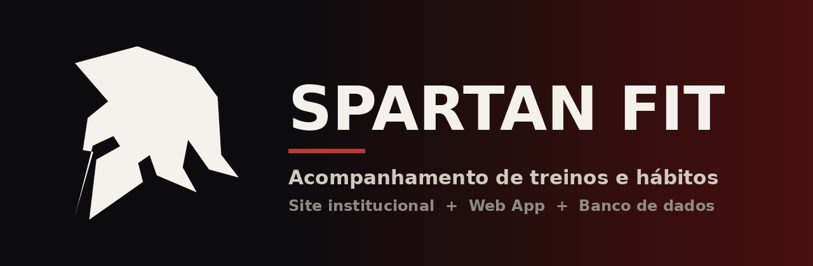

<div align="center">



<br>

**Plataforma web de acompanhamento de treinos e hábitos, com site institucional, web app e banco de dados.**


[Funcionalidades](#-funcionalidades) •
[Tecnologias](#-tecnologias) •
[Como rodar](#-como-rodar) •
[Estrutura](#-estrutura-do-projeto) •
[Banco de dados](#-banco-de-dados) •
[API](#-api)

</div>

---

## 🛡️ Sobre

O SpartanFit nasceu como dois protótipos separados: um site institucional e um web app cujos dados ficavam apenas na memória do navegador. Em outubro de 2026, os dois foram unidos em um sistema único, com **autenticação real** e **banco de dados MySQL**.

Desenvolvido como Trabalho de Conclusão de Curso (TCC), 2026.

## ✨ Funcionalidades

**Site**
- Apresentação do projeto com navegação em página única e animações
- Questionário de avaliação física com 10 perguntas
- Cadastro e login com senhas criptografadas (hash)

**Web app**
- Painel com Para você, Treinos, Tarefas, Nutrição, Metas, Progresso e Perfil
- Acesso protegido por sessão: sem login, volta ao site
- Perfil salvo no banco: nome, e-mail, peso, altura, nível e meta de sono
- Cálculo automático de IMC, troca de senha e logout
- Design responsivo (desktop e mobile)

## 🧰 Tecnologias

| Camada   | Tecnologia                            |
|----------|---------------------------------------|
| Frontend | HTML5, CSS3, JavaScript (vanilla)     |
| Animação | GSAP e Lenis (rolagem suave)          |
| Backend  | PHP (vanilla)                         |
| Banco    | MySQL (PDO)                           |
| Servidor | XAMPP (Apache + MySQL)                |
| Fontes   | Anton, Inter e Poppins (Google Fonts) |

## 🚀 Como rodar

1. Inicie o **XAMPP** (Apache + MySQL)
2. Copie o projeto para a pasta `htdocs`, ficando `htdocs/spartanfit`
3. Acesse `http://localhost/spartanfit/index.html`
4. Em **Login/Criar Conta**, crie sua conta

O banco e as tabelas são criados automaticamente no primeiro cadastro. Se preferir, importe o `database.sql` pelo `http://localhost/phpmyadmin`.

> [!NOTE]
> O projeto usa PHP e MySQL, então **não funciona no GitHub Pages**. É preciso rodar em um servidor com PHP, como o XAMPP.

### Configuração do banco

Credenciais padrão em `api/config.php`:

| Parâmetro | Valor      |
|-----------|------------|
| Host      | 127.0.0.1  |
| Database  | spartanfit |
| Usuário   | root       |
| Senha     | (vazio)    |

## 📁 Estrutura do projeto

```
├── index.html                # Site institucional
├── style.css                 # Estilos do site
├── script.js                 # Lógica do site (quiz, cadastro e login)
├── app.html                  # Web app (painel do usuário)
├── database.sql              # Schema do banco (uso manual no phpMyAdmin)
│
├── api/
│   ├── config.php            # Dados de conexão com o banco
│   ├── bootstrap.php         # Conexão PDO, sessão e funções comuns
│   ├── schema.sql            # Schema usado na criação automática do banco
│   ├── register.php          # Cadastro
│   ├── login.php             # Login
│   ├── logout.php            # Encerramento de sessão
│   ├── me.php                # Dados do usuário logado
│   ├── profile.php           # Salvar perfil
│   ├── password.php          # Trocar senha
│   └── state.php             # Dados do app (reservado)
│
├── banner.png                # Banner do README
└── imagens e vídeo           # Logo, símbolo, foto de perfil e fundo
```

## 🗄️ Banco de dados

- **users**: contas (nome, e-mail único, senha com hash)
- **profiles**: peso, altura, nível, meta de sono e respostas do quiz (FK para users com CASCADE)
- **app_state**: dados do app em JSON, reservada para treinos, metas, água e sono (FK para users com CASCADE)

## 🔌 API

| Arquivo      | Método   | Descrição                                           |
|--------------|----------|-----------------------------------------------------|
| register.php | POST     | Cria a conta e o perfil e inicia a sessão           |
| login.php    | POST     | Confere e-mail e senha e inicia a sessão            |
| logout.php   | POST     | Encerra a sessão                                    |
| me.php       | GET      | Retorna o usuário logado (401 se não houver sessão) |
| profile.php  | POST     | Atualiza nome, e-mail, peso, altura, nível e sono   |
| password.php | POST     | Troca a senha após conferir a atual                 |
| state.php    | GET/POST | Lê e grava os dados do app em JSON                  |

## 🔒 Segurança

- Senhas com `password_hash`
- Consultas com prepared statements (PDO)
- Cookie de sessão HttpOnly e SameSite=Lax
- Validação repetida no servidor
